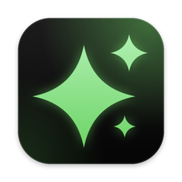
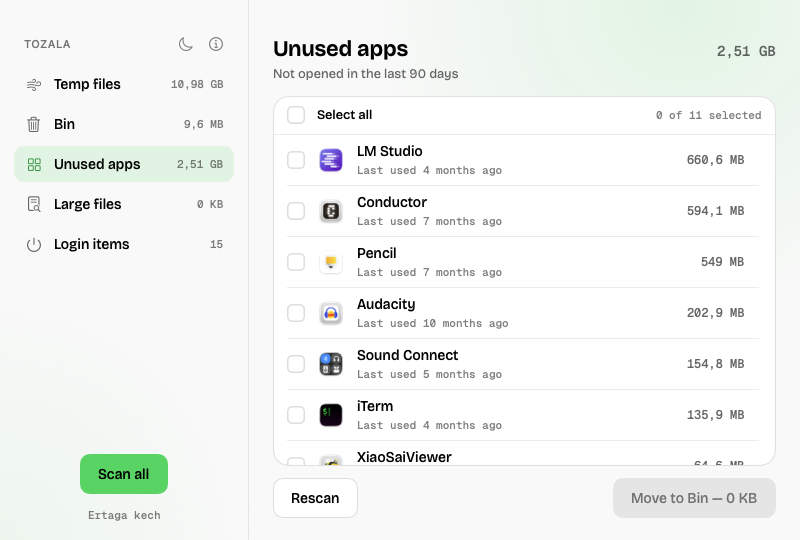

<p align="center">
  
</p>

<h1 align="center">Tozala</h1>

<p align="center">
  <a href="https://t.me/ertagakech">
    <picture>
      <source media="(prefers-color-scheme: dark)" srcset="docs/ertagakech-logo-white.svg">
      
    </picture>
  </a>
</p>

<p align="center">
  A small, native cleaner for macOS: temp files, the Bin, unused apps, large files and login items.
</p>

<p align="center">
  <a href="https://github.com/anvarnarz/tozala/releases/latest/download/Tozala.zip"><b>⬇ Download for macOS</b></a>
  &nbsp;·&nbsp; Apple silicon · macOS 15+
</p>

<p align="center">
  <picture>
    <source media="(prefers-color-scheme: dark)" srcset="docs/screenshot-dark.png">
    
  </picture>
</p>

*Tozala* means "clean it" in Uzbek.

## What it cleans

| | Finds | Action |
|---|---|---|
| **Temp files** | `~/Library/Caches`, `~/Library/Logs`, your temp folder | Move to Bin |
| **Bin** | Everything in `~/.Trash` | Empty Bin (permanent, asks first) |
| **Unused apps** | Apps in `/Applications` and `~/Applications` not opened in 90 days | Move to Bin |
| **Large files** | Files of 500 MB or more in your home folder (outside `~/Library`) | Move to Bin, or reveal in Finder |
| **Login items** | Launch agents in `~/Library/LaunchAgents` and `/Library/LaunchAgents` | Turn off / on (`launchctl disable`, reversible) |

## Safe by default

- Scans are read-only. Nothing is removed until you tick it and press the button.
- Everything goes to the **Bin**, so you can put it back. Only *Empty Bin* is permanent, and it asks first.
- Never touches `/System`, `/usr`, Apple apps, Apple launch agents, or Tozala itself. Symlinks are never followed.
- Turning off a login item doesn't delete anything. Turn it back on any time.

## Install

1. [Download Tozala.zip](https://github.com/anvarnarz/tozala/releases/latest/download/Tozala.zip), unzip it, and move **Tozala.app** to **Applications**.
2. Open it once. The app isn't notarized, so macOS blocks the first launch: go to **System Settings → Privacy & Security** and click **Open Anyway**.
3. To see the Bin's size, give Tozala **Full Disk Access** (the app links you there when it's needed).

## Build from source

Needs only Command Line Tools (`xcode-select --install`).

```bash
./build.sh
```

This compiles the app, draws the icon, signs it ad-hoc, and installs it to `/Applications`. Use `./build.sh --no-install` to only build into `build/`.

Run the engine self-test (works in a temp folder, never on your data):

```bash
swiftc -parse-as-library -swift-version 5 Sources/Tozala/Cleaner.swift scripts/selftest.swift -o build/selftest && build/selftest
```

## Project structure

```
Sources/Tozala/
  TozalaApp.swift    app entry, windows
  Model.swift        UI state per category (idle → scanning → ready → cleaning)
  ContentView.swift  sidebar, item lists, About window
  Cleaner.swift      scanning and cleaning engine
  Theme.swift        Ertaga kech design tokens (light + dark)
scripts/
  icon.swift         draws the app icon
  selftest.swift     engine self-test
```

## License

MIT
